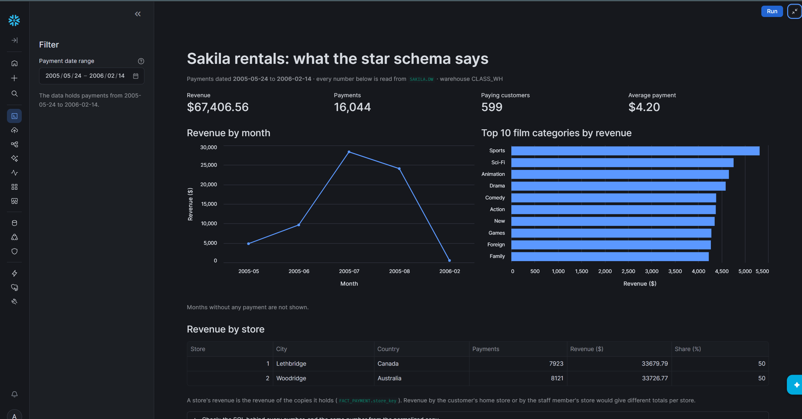
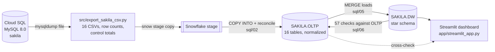
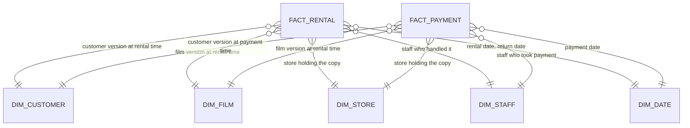

# Sakila: from Cloud SQL (MySQL) to a Snowflake star schema

[](https://github.com/ajace13/sakila-snowflake-star-schema/actions/workflows/ci.yml)

I moved the Sakila DVD-rental database from MySQL 8.0 on Google Cloud SQL into Snowflake, proved nothing was lost, and then turned the normalized copy into a star schema for analytics. Every load is a `MERGE` you can re-run safely. Two dimensions keep full history (Type 2). Every number is reconciled back to the source.

**In numbers**

- **16 tables and 47,268 rows** migrated. Row counts, 22 foreign keys and 17 control totals (sums, null counts and a checksum) all match the source.
- **57 of 57 reconciliation checks pass.** Revenue in the star is 67,406.56, matching the normalized copy to the cent.
- **Re-running all seven loads changes 0 rows.** Five logged runs show it.
- **A customer moves from Japan to Spain**, and their earlier payments stay reported under Japan. The demo does this inside a transaction and rolls it back.
- **Found one question the model answers badly.** Revenue by actor comes out 5.45 times too high. I designed a fix, a weighted bridge table, and checked that it reconciles.
- **A dashboard shows its own SQL** and checks each number against the normalized copy (7 of 7 match).



## Try it without a Snowflake account

The Snowflake account this ran on was a temporary trial, so the repo includes a local version. It builds the same star from the committed CSVs in DuckDB and runs the key reconciliation checks:

```bash
pip install duckdb pandas
python demo/build_star_duckdb.py
```

```
check                                                           star    normalized  result
rentals                                                        16044         16044  MATCH
payments                                                       16044         16044  MATCH
customers                                                        599           599  MATCH
films                                                           1000          1000  MATCH
revenue                                                     67406.56      67406.56  MATCH
days out                                                       79705         79705  MATCH
revenue by month (groups that differ)                              0             0  MATCH
revenue by category (groups that differ)                           0             0  MATCH
revenue by store holding the copy (groups that differ)             0             0  MATCH
duplicate fact keys                                                0             0  MATCH

10 of 10 checks match
```

To run the tests too, use `pip install -r requirements.txt` and then `pytest`. The exporter test regenerates every CSV from the public Sakila dump and compares it byte for byte with what is committed. It runs when `sakila-db/sakila-data.sql` is present, which you get by unpacking [sakila-db.tar.gz](https://downloads.mysql.com/docs/sakila-db.tar.gz) in the repo root. Without the dump, that test is skipped.

## How it fits together



The normalized copy in `SAKILA.OLTP` is kept as it is, and the star is only ever built from it. That way every figure in the star can be checked against a second, independent route to the same answer.

## The star schema



| Table | Rows | History | Grain |
|---|---:|---|---|
| `FACT_RENTAL` | 16,044 | | one rental: one copy, one customer, one date, one staff member |
| `FACT_PAYMENT` | 16,044 | | one payment: one amount, one customer, one staff member, one date |
| `DIM_CUSTOMER` | 599 | **Type 2** | one version of a customer (address, store, active flag and contact details tracked) |
| `DIM_FILM` | 1,000 | **Type 2** | one version of a film (price, rental terms and rating tracked) |
| `DIM_STORE` | 2 | Type 1 | one store |
| `DIM_STAFF` | 2 | Type 1 | one staff member |
| `DIM_DATE` | 9,497 | Type 0 | one calendar day, 2005 to 2030, plus a "not returned yet" member |

The grain of each fact is written into its DDL as a table `COMMENT`, so it travels with the table.

### Design decisions

- **Two facts, not one.** Rentals and payments match one to one by count, which makes a single table tempting. But in 8,078 payments the staff member who took the money is not the one who handled the rental. And in 7,317 payments the amount differs from the film's list price. A payment is its own event, so it gets its own fact.
- **Customer and film are Type 2.** Customers move and change store, and films get re-priced. A rental should be reported against the customer and the price as they were that day. The source keeps only today's values, so the history has to be built here.
- **Store and staff are Type 1, on purpose.** There are two of each. Overwriting loses only which store a staff member used to work at, and the DDL says so.
- **"Store" means three different things in Sakila**: the customer's home store, the store of the staff member who took the payment, and the store holding the rented copy. Store 1's revenue moves by about 10% depending on which you pick. The star uses the store holding the copy and names this in the column comments.
- **Snowflake does not enforce keys**, so `sql/06_dw_checks.sql` asserts all of them. It covers no duplicate fact keys, no orphaned foreign keys, one current version per customer and film, no overlapping or gapped history, and every fact pointing at the version valid at its event time.

The full reasoning, including the review by a schema-review subagent and what changed because of it, is in [docs/dimensional_model.md](docs/dimensional_model.md).

### How the MERGE loads stay safe to re-run

- **Type 0 and Type 1 dimensions** update only when a hash of the attributes changes. The hash is `MD5(TO_JSON(ARRAY_CONSTRUCT(...)))`, which tells a NULL from an empty string.
- **Type 2 dimensions** use one `MERGE` each. Every changed source row is staged twice: once keyed to close the current version, and once with a NULL key so it can only insert the new version.
- **Facts** merge on the source id (`rental_id`, `payment_id`). Dimension keys come from `LEFT JOIN`s, so a failed lookup stops the load with an error instead of silently dropping the row. A returned rental updates the existing row (`return_date_key`, `days_out`) rather than adding a second one.

| Run | What happened | Rows inserted in the 7 MERGEs |
|---|---|---|
| 1 | first load | 731 · 2 · 2 · 599 · 1,000 · 16,044 · 16,044 |
| 2 | re-run, nothing changed | all 0 |
| 3 | calendar extended to 2030 | 8,766 dates, all else 0 |
| 4, 5 | re-runs | all 0 |

Logs: [evidence/](evidence/) (`dw_load_log_run1.txt` to `run5.txt`).

## Where the model falls short

The analysis does not stop at "it works". [docs/business_questions.md](docs/business_questions.md) answers three business questions on both the normalized copy and the star, then looks for where they disagree:

- **Revenue by month and by category** agree to the cent on both models.
- **Revenue by customer country** disagrees once a customer has moved, and both answers are right. The normalized copy can only say where customers live now. The star says where they were when they paid.
- **Revenue by actor** can't be answered by the star at all. On the normalized copy, the obvious join counts each payment once per actor, which overstates revenue 5.45 times (367,559.07 against 67,406.56). The fix is a bridge table with a weighting factor plus an "unknown actor" member for the 3 films with no cast. Its allocated total is exactly 67,406.56.

## What would break first at scale

At 1,000 times the data (about 16 million rentals), the **Python exporter** fails first. It reads the whole dump into memory: 41 MB today, about 40 GB extrapolated. The MERGEs come next, because they compare all source and target rows on every run, so their cost grows with total history rather than with what changed. The fix for each part (stream the export, make the MERGEs incremental with Snowflake streams, move the dashboard's cross-checks behind a button) is in [docs/reflection.md](docs/reflection.md), along with what broke during the build and how each problem was caught.

## The dashboard

[app/streamlit_app.py](app/streamlit_app.py) reads only `SAKILA.DW` for what it shows. It has four KPIs, revenue by month, top categories and revenue by store, all filtered by payment date. A "Check" panel shows the SQL behind every number and runs the same question on `SAKILA.OLTP`, so a viewer can see the two models agree. It runs locally with the Snowflake connector and as Streamlit in Snowflake. [app/verify_streamlit_app.py](app/verify_streamlit_app.py) tests it headlessly with Streamlit's `AppTest`. Details: [docs/dashboard.md](docs/dashboard.md).

## Working with an AI agent, and checking it

I built this with Claude Code acting as a **read-only** warehouse agent. It used its own Snowflake user, and its role had `SELECT` only. The standing rules it worked under are in [agent/CLAUDE.md](agent/CLAUDE.md), and the subagent that reviewed the DDL is in [agent/grain-reviewer.md](agent/grain-reviewer.md).

Every claim the AI made about query plans, costs and the data was checked against Snowflake's own answer. I then marked each one right or wrong. That record is [docs/ai_verification.md](docs/ai_verification.md), with the raw evidence in [evidence/ai_checks/](evidence/ai_checks/). The check also found that the agent's user held more privilege than intended, and recorded that as a finding. The prompts are logged in [docs/prompt_log.md](docs/prompt_log.md).

## Run it on Snowflake

You need a Snowflake account with `SYSADMIN` (and `ACCOUNTADMIN` only for the read-only grants). Run the scripts in order:

| Step | Script | What it does |
|---|---|---|
| 0 | `sql/00_source_counts_mysql.sql` | (optional) the same counts and control totals on the live MySQL source |
| 1 | `src/export_sakila_csv.py` | dump → 16 CSVs plus counts and control totals (already committed in `data/`) |
| 2 | `sql/01_oltp_ddl.sql` | database `SAKILA`, schema `OLTP`, 16 tables, file format, stage |
| 3 | upload `data/csv/*.csv` | `snow stage copy "data/csv/*.csv" @SAKILA.OLTP.SAKILA_STAGE` |
| 4 | `sql/02_oltp_load_reconcile.sql` | `COPY INTO` all 16 tables, then reconcile: counts, control totals, keys |
| 5 | `sql/03_read_only_grants.sql` | `SELECT`-only access for the agent's role |
| 6 | `sql/04_dw_ddl.sql` | the star in `SAKILA.DW` (uses `IF NOT EXISTS`: Type 2 history can't be rebuilt) |
| 7 | `sql/05_dw_load_merge.sql` | all seven MERGE loads; safe to re-run |
| 8 | `sql/06_dw_checks.sql` | 57 checks; every row must say `OK` |
| 9 | `sql/07_scd2_demo.sql` | Type 2 demo inside a transaction that rolls back |
| 10 | `sql/08_business_questions.sql` | the business questions on both models |
| 11 | `streamlit run app/streamlit_app.py` | the dashboard (uses the Snowflake CLI connection set in `SNOWFLAKE_CONNECTION_NAME`) |

Step-by-step migration notes, including the type mapping from MySQL to Snowflake, are in [docs/migration.md](docs/migration.md). Every table and column is described in [docs/data_dictionary.md](docs/data_dictionary.md).

## Repository layout

```
sql/          numbered Snowflake scripts (00 runs on MySQL)
src/          the dump-to-CSV exporter
data/         the 16 exported CSVs, source row counts and control totals
demo/         the same star built locally in DuckDB, with reconciliation checks
app/          Streamlit dashboard, headless test, screenshot script
docs/         design notes, migration, business questions, dashboard, AI verification, reflection
evidence/     saved output of every load, check and demo run
agent/        the Claude Code agent's standing rules and the schema-review subagent
notebooks/    walkthrough notebook, executed against Snowflake, with all outputs
tests/        exporter and DuckDB demo tests
```

## Credits

Built for ADSP 31011 Cloud-Native Data Engineering at the University of Chicago, Autumn 2026. The Sakila sample database is © Oracle Corporation and distributed under the New BSD license. The CSVs in `data/csv/` are an export of it. My own code is MIT licensed (see [LICENSE](LICENSE)).
